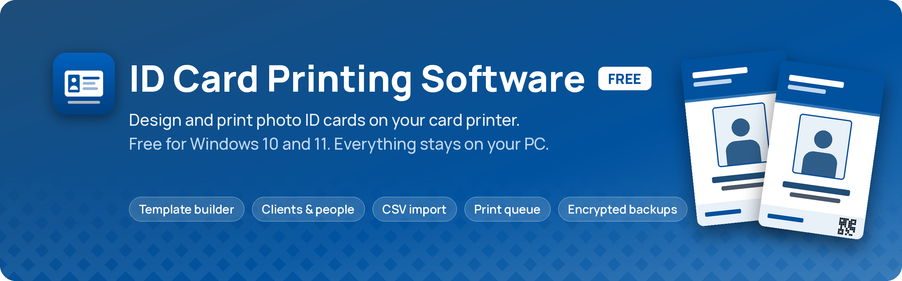
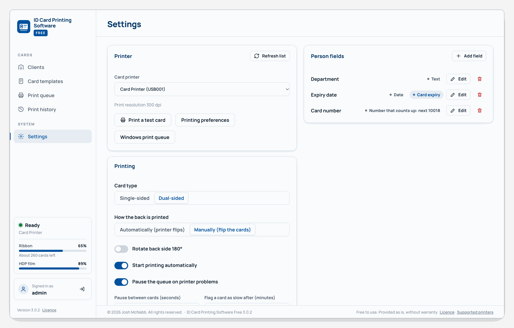

<p align="center">
  
</p>

<h1 align="center">ID Card Printing Software Free</h1>

<p align="center">
  <b>Design and print photo ID cards on your card printer. Free, for Windows.</b><br>
  Clients and their people, a drag-and-drop card template builder, CSV import with photos, and a print queue that
  prints through the printer's own Windows driver with live printer status and a full print history.
</p>

<p align="center">
  <a href="https://github.com/CyborgFingers/id-card-printing-software/releases/latest"></a>
  
  <a href="legal/LICENSE.txt"></a>
</p>

<p align="center">
  <a href="https://github.com/CyborgFingers/id-card-printing-software/releases/latest"></a>
</p>

<p align="center">
  Download the setup from the <a href="https://github.com/CyborgFingers/id-card-printing-software/releases/latest">latest release</a>, run it, and sign in.<br>
  Everything you enter stays on your PC in one encrypted database.
</p>

---

## What it does

The program starts empty and ready to set up: create your first card template in the builder, add a client, then
add their people (or import them from a spreadsheet with their photos) and print.

<p align="center">
  
</p>
<p align="center"><b>Template builder.</b> Drag photos, text, logos, shapes and barcodes onto the front and back of the card, then see it with sample text or a real person.</p>

<p align="center">
  
</p>
<p align="center"><b>Print queue.</b> One card at a time, with a live count, the printer's status and its ribbon levels while it prints.</p>

<table>
  <tr>
    <td width="50%"></td>
    <td width="50%"></td>
  </tr>
  <tr>
    <td align="center"><b>Clients.</b> One place for each organisation you print for, with their people, templates and history.</td>
    <td align="center"><b>People.</b> Photos, staff numbers and your own fields such as department or expiry date. Tick people and print.</td>
  </tr>
  <tr>
    <td width="50%"></td>
    <td width="50%"></td>
  </tr>
  <tr>
    <td align="center"><b>Print history.</b> Every card ever printed, who printed it and the ribbon level at the time. Export to CSV.</td>
    <td align="center"><b>Settings.</b> Printer, dual-sided printing, your own person fields, users, backups and appearance.</td>
  </tr>
</table>

<sub>The screenshots show made-up example organisations and people with illustrated placeholder photos.</sub>

## Features

### Design
- **Card template builder**: drag, resize and snap elements, with undo and redo and a live preview with sample text.
- **Elements**: photo, name and other person details, fixed text, logos and images, shapes, and barcodes
  (QR code, Data Matrix, PDF417, Code 128, Code 39) that read from a person's details.
- **Front and back** on one template, each with its own background image or colour.
- **Card sizes**: CR80 (85.6 × 54 mm), CR79, CR100 or a custom size from 20 to 150 mm, portrait or landscape.
- **Text that fits**: fonts (bundled, so cards print the same on any PC), weights, colours, letter spacing, rotation,
  automatic shrink-to-fit and date formats for date fields.
- **Templates are a library**: assign one template to several clients, or give each client its own.

### People
- **Clients** with contact details, their people, and the templates they print with.
- **People** with a photo (drag the photo to position it, scroll to zoom), first and last name, staff ID number,
  position, title, address and notes.
- **Your own fields**, added in Settings: text, dates (one can be the card expiry) and numbers that count up by
  themselves, such as a card number.
- **Import from CSV** with a folder of photos: name each photo after the person (`John Smith.jpg`, `johnsmith.jpg`
  or `JOHN SMITH.jpg` all match John Smith), or name the photo file in the CSV. Photos are matched automatically and fitted to the card's photo frame, with a
  review step before anything is saved.
  Export people and print history to CSV.
- **Card status**: mark cards lost or returned, see cards that are expired or expiring soon, and filter people who have
  never been printed.
- **Proof sheets**: the chosen people's cards at actual size on one page, to print or save as a PDF for the client to
  check.

### Printing
- **Prints through the printer's own Windows driver**, one card at a time, at the printer's resolution (300 or
  600 dpi).
- **Print queue** with batches, progress, reprint, cancel and move-to-front. Finished batches can be cleared.
- **Pauses on printer problems** (ribbon out, card jam, offline, cover open) and carries on when you resume. A card is
  never printed twice without someone confirming it: anything mid-print when the program was closed is marked
  "Check output" for you to decide.
- **Dual-sided cards** in one pass on printers with a flipper, or print the fronts, flip the stack and press
  **Print backs** on printers without one.
- **Live printer status** in the sidebar: ready, busy, alerts, and on HID FARGO printers the ribbon and film levels,
  card counter and an estimate of cards left.
- **Print history** of every card with the client, batch, template, operator and ribbon level at the time.
- **Keeps printing in the background**: closing the window leaves the program running in the notification area, and
  it can start with Windows. Windows notifications say when printing finishes or the printer needs attention.
- **Picks up where it left off**: if the PC restarts or the printer is unplugged mid-batch, the queue shows the one
  card to check and carries on from the next card when you resume.

### Security and backups
- **Administrator and operator accounts.** Operators add people and print; administrators do everything else.
  New accounts must choose their own password; too many wrong passwords pauses sign-in; idle sessions sign out.
- **One encrypted database** holds everything, including photos and card images. The key is tied to your Windows
  account, so a copied database file cannot be opened elsewhere.
- **Encrypted backups** (`.idcbak`) protected by a backup password you choose: download one whenever you like, or turn
  on automatic daily or weekly backups to a folder or network share and keep the newest few.
- **Restore** from a backup on this PC or a new one.

### Updates
- The program checks the GitHub releases of this repository for a newer version. Administrators see a banner and can
  install it with **Update now**; the download is verified before it runs, the program closes and reopens by itself,
  and your data is untouched.

## Supported printers

Cards are printed through the printer's own Windows driver, so the driver must be installed first and the printer
must accept the card size you use.

- **HID FARGO printers**: printing, live status and alerts, with ribbon and film levels, card counter and flipper
  detection read from the FARGO driver. Developed against the HDP5000; the DTC and HDP ranges use the same driver
  family.
- **Any other card printer with a Windows driver** (for example Zebra, Evolis, Magicard, Entrust and IDP printers):
  printing works through the driver, and alerts are limited to what Windows reports. Ribbon levels are not shown.
- Not supported: ordinary office and photo printers, label printers, and network print services without a Windows
  card-printer driver.

The full list, with notes on dual-sided printing, is in [legal/SUPPORTED-PRINTERS.txt](legal/SUPPORTED-PRINTERS.txt).

## Install

**Requirements**

- Windows 10 (version 1809 or later) or Windows 11, 64-bit
- A card printer with its Windows driver installed
- Administrator rights to run the setup (it installs for everyone on the PC)

**Steps**

1. Download `ID-Card-Printing-Software-Free-Setup-<version>.exe` from the
   [latest release](https://github.com/CyborgFingers/id-card-printing-software/releases/latest) and run it.
2. The setup installs the Microsoft .NET 10 runtimes (bundled, so this works offline) and the Microsoft Edge WebView2
   Runtime (downloaded) if they are not already on the PC.
3. Open the program, sign in with `admin` / `admin`, choose your own password and accept the licence.

**About the SmartScreen prompt.** The setup is not code-signed, so the first time you run it Windows shows
"Windows protected your PC". Click **More info**, then **Run anyway**, and answer **Yes** to the "unknown publisher"
prompt. You will see this once; updates installed through **Update now** do not show it. You can check a download
against the SHA-256 digest shown on its release page.

**Where your data lives.** Everything is in one encrypted database at
`%LOCALAPPDATA%\ID Card Printing Software`. Installing a new version over an old one keeps it, and uninstalling the
program leaves it in place; delete that folder yourself if you want it gone.

## Privacy

Everything stays on the PC. People, photos, templates, settings and print history live in the one encrypted
database and are never sent anywhere. The only network connection the program makes is the check for new versions
against GitHub (and the WebView2 download during setup, if it is missing). There is no account, no telemetry and no
licence server.

## User guide

The **[user guide](docs/USER-GUIDE.md)** explains every part of the program step by step: templates, clients and
people, importing with ID photos, printing and the queue, dual-sided cards, printer alerts, users, backups and
troubleshooting. The same guide is built into the program: choose **Help** in the sidebar, or press **F1**, and search
it.

## FAQ

<details>
<summary><b>I have forgotten the admin password</b></summary>

Any administrator can reset another user's password from **Settings > Users**. If nobody can sign in, sign in to
Windows as the person who uses the program, then run

```
"C:\Program Files\ID Card Printing Software Free\ID Card Printing Software.exe" --reset-admin
```

It puts the `admin` account back to the password `admin` and asks for a new one at the next sign-in. It only works
for the Windows account whose database it is, so nobody else can use it to get in.
</details>

<details>
<summary><b>How do I move to a new PC?</b></summary>

Make a backup on the old PC (**Settings > Backup > Download backup**, with a backup password), install the program on
the new PC, then **Restore from backup** in Settings with that file and password. Copying the database file across
does not work: its key belongs to the Windows account on the old PC.
</details>

<details>
<summary><b>Does it need the internet?</b></summary>

No. Printing, designing, importing and backups all work offline. The internet is only used to check for new versions
and to install them, and by the setup to download the WebView2 Runtime if the PC does not have it.
</details>

<details>
<summary><b>Can my cards have two sides on a printer without a flipper?</b></summary>

Yes. In **Settings > Printing** choose "Manually (flip the cards)". The queue prints the fronts, you flip the stack and
load it again, and **Print backs** prints the other side in the same order.
</details>

<details>
<summary><b>Where is the program after I close its window?</b></summary>

In the notification area, still printing. Double-click its icon to open the window again. To stop it completely use
**Settings > Close the program**.
</details>

## Building from source

The program is C# (.NET 10). The screens are plain HTML, CSS and JavaScript in `web/`.

```bash
dotnet test desktop/tests/IdCard.Tests          # unit tests
dotnet build desktop/src/IdCard.Desktop         # the Windows program
```

For development, the service also runs on macOS or Linux (`desktop/src/IdCard.DevHost`) with a simulated printer
that is not part of the released program. The installer is built with Inno Setup 6 (`tools/build-installer.ps1`), and pushing
a version tag (for example `v3.0.1`) builds the setup and publishes a release. See [CLAUDE.md](CLAUDE.md) for the
developer notes: layout, design decisions and the testing approach.

## Licence

ID Card Printing Software Free is **free to use** under its [licence](legal/LICENSE.txt). It is proprietary software,
not open source: the source is published so you can see how it works, but it may not be resold, redistributed or
modified, and the licence applies to the source as well as the installed program. Third-party components are listed
in [THIRD-PARTY-NOTICES.txt](legal/THIRD-PARTY-NOTICES.txt). Provided as is, without warranty.

Copyright (c) 2026 Josh McNabb. All rights reserved.
