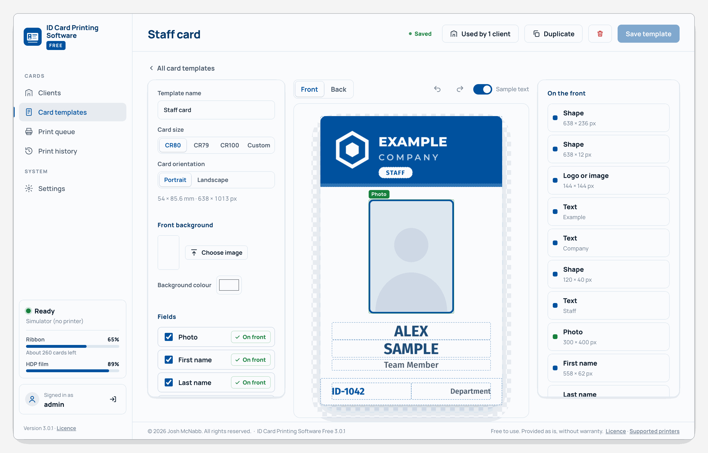
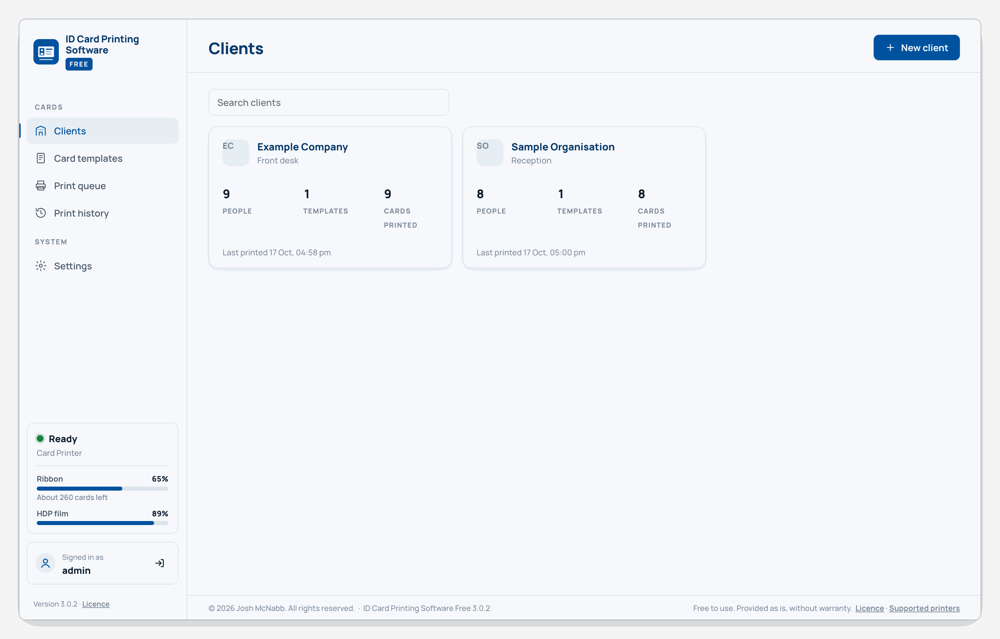
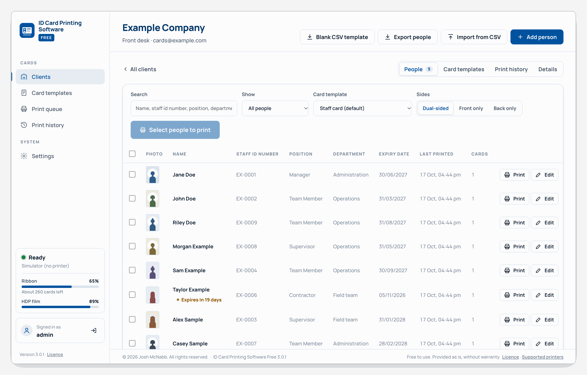
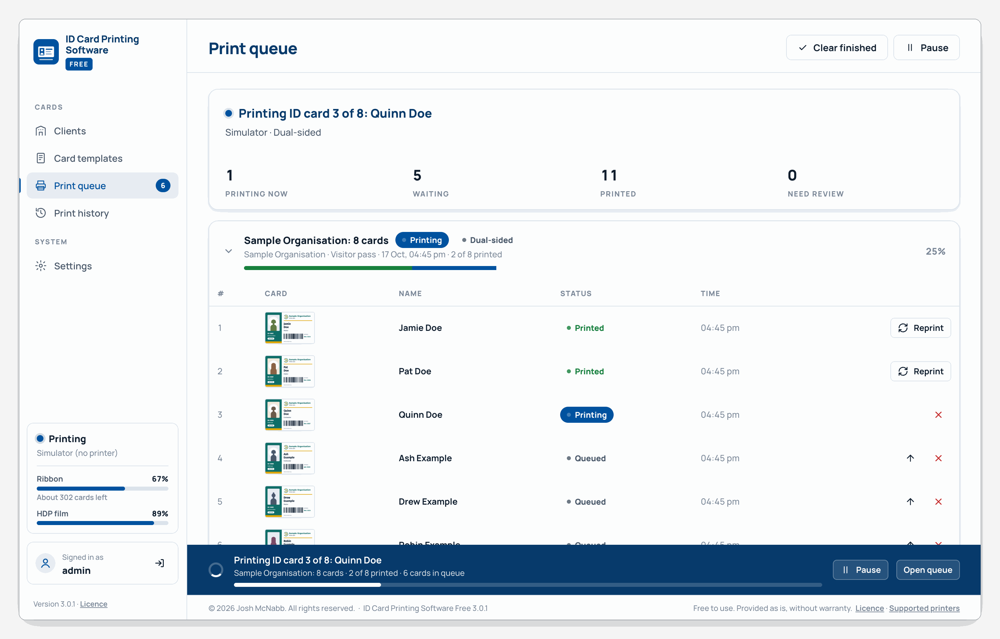
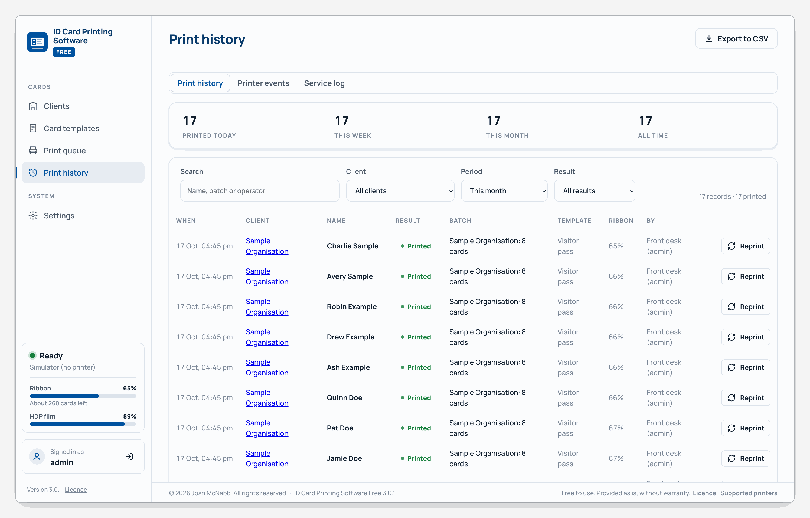

# ID Card Printing Software Free: user guide

Step-by-step help for every part of ID Card Printing Software Free. The same guide is built into the program:
choose **Help** in the sidebar (or press **F1**) and search it.

## Contents

- [Getting started](#getting-started)
- [Card templates](#card-templates)
- [Clients](#clients)
- [People](#people)
- [Importing people from a spreadsheet](#importing-people-from-a-spreadsheet)
- [Printing cards](#printing-cards)
- [The print queue](#the-print-queue)
- [Dual-sided cards](#dual-sided-cards)
- [Printer setup and status](#printer-setup-and-status)
- [Printer alerts](#printer-alerts)
- [Print history](#print-history)
- [Person fields](#person-fields)
- [Users and passwords](#users-and-passwords)
- [Backups and moving to a new PC](#backups-and-moving-to-a-new-pc)
- [Appearance](#appearance)
- [Updates](#updates)
- [Closing the program](#closing-the-program)
- [Troubleshooting](#troubleshooting)

## Getting started

Install the program, sign in for the first time, and get ready to print your first card.

### Install

1. Download the setup from the program's GitHub releases page and run it.
2. If Windows shows *Windows protected your PC*, choose **More info**, then **Run anyway**. This only happens the first time, because the setup isn't code-signed.
3. Follow the setup: read the licence and choose **I accept the agreement**. It installs the Microsoft components the program needs if they're missing.
4. Tick **Start automatically when anyone signs in to Windows** if you want printing to be ready as soon as the PC starts.

### Sign in for the first time

1. Open **ID Card Printing Software Free** from the Start menu.
2. Sign in with the username `admin` and the password `admin`.
3. Choose your own password (at least 8 characters). You can't use the program until you do.

### Your first card, step by step

1. Choose your card printer in **Settings**. See [Printer setup and status](#printer-setup-and-status).
2. Create a card template in **Card templates**. See [Card templates](#card-templates).
3. Add a client in **Clients**, such as *Example Company*. See [Clients](#clients).
4. Add the client's people one at a time, or [import them from a spreadsheet](#importing-people-from-a-spreadsheet).
5. Tick the people and choose **Print**. See [Printing cards](#printing-cards).

### Finding your way around

The sidebar on the left takes you to each part of the program:

| Sidebar | What it's for |
|---|---|
| Clients | The organisations you print for, their people and their cards |
| Card templates | Designing the cards (administrators only) |
| Print queue | Cards waiting to print, printing now and just printed |
| Print history | Every card ever printed |
| Settings | Printer, printing options, users, backups and appearance |
| Help | This guide |

Below the menu, the printer status shows whether the printer is ready. Click it for the printer's details.

Press **F1** at any time to open Help, and type in its search box to find a topic.

> **Tip:** Closing the window doesn't stop the program. It keeps running in the notification area by the clock, so cards keep printing. See [Closing the program](#closing-the-program).

## Card templates

A card template is the design of a card: its size, background, the photo frame, and where each person's details go. Administrators design templates in **Card templates**.

### Create a template

1. Choose **Card templates** in the sidebar, then **New template**.
2. Type a name, such as *Staff card*.
3. Under **Start from**, choose **A blank card**, or a copy of an existing template.
4. Choose **Create and open**. The template builder opens.

### Choose the card size

In the builder's left panel, under **Card size**, choose:

| Size | Card (mm) | Pixels at 300 dpi | Use |
|---|---|---|---|
| CR80 | 85.6 × 54 | 1013 × 638 | The usual ID card |
| CR79 | 83.9 × 52.1 | 991 × 615 | Adhesive-backed cards |
| CR100 | 98.5 × 67 | 1163 × 791 | Larger ID cards and badges |
| Custom | 20 to 150 | Worked out from the size | Any other size |

Then choose **Portrait** or **Landscape** under **Card orientation**. Your printer must accept the card size you choose.

### Add a background

1. Under **Front background**, choose **Choose image** and pick a picture: JPG, PNG, HEIC (iPhone photos), WebP, TIFF, AVIF, BMP, GIF or SVG.
2. Or pick a **Background colour** instead.
3. Choose **Save template** to keep it.

The picture fills the whole card. If it's a different shape from the card, its edges are trimmed rather than squashed, so for the best result make it the card's shape, for example 638 × 1013 pixels for a portrait CR80 card.

To fade the background picture, for example behind text, drag **Image opacity** below it. To make it darker or richer, drag **Darkness** (which darkens the whole picture, white areas too), **Contrast** and **Colour**. Logos and the ID photo frame have the same three settings when selected; on the photo frame they apply to every person's photo.

### Put people's details on the card

1. Under **Fields**, tick each detail the card shows: **Photo**, **First name**, **Last name**, **Staff ID number**, **Position**, **Title**, **Address**, and any [person fields](#person-fields) you've added.
2. Drag each ticked field's **Drag onto card** button onto the card, or click it to place it in the middle.
3. Drag a field to move it, and drag its edges to resize it. Guide lines appear when it lines up with the card or other fields.

The **Sample text** switch above the card shows example details (*Alex Sample*) so you can see how the card will look.

### Add text, logos, shapes and barcodes

Under **Design**, add things that are the same on every card:

- **Add text** for fixed words, such as *VISITOR*.
- **Add logo or image** for a logo. Choose **Fit inside** to show the whole image, or **Fill box** to fill the box and crop the edges.
- **Add shape** for coloured bands and boxes, with a fill, border and rounded corners.
- **Add barcode or QR code**: choose the **Type** (QR code, Data Matrix, PDF417, Code 128 or Code 39) and the **Data** it holds, such as the Staff ID number, or fixed text.

### Style the selected field

Click a field on the card to select it. The right panel shows its settings:

- **Text**: font, weight, size, colour, **CAPITALS**, alignment, rotation and letter spacing. Text always stays inside its box: a long name shrinks down to the **Smallest** size, then moves onto two lines if the box has room, then shrinks further.
- **Dates**: choose the **Date format**, such as 31/03/2027 or 31 Mar 2027.
- **Photo**: the frame's photo size shows under **Photos**, such as *At least 360 × 480 px · 30.5 × 40.6 mm · 3:4 portrait*. Choose **Fill the frame** (photos of another shape are trimmed at the edges) or **Whole photo** (nothing is cut off; any space shows the frame's colour). Also corner radius, border, the frame's colour, and **Make 3:4 portrait** for the usual photo shape. Each person's photo can still be moved and zoomed when you add or edit them.
- **Position and size**: exact X, Y, width and height in pixels, plus **Centre horizontally**, **Centre vertically**, **Centre on card** and **Full width**.

Use the bin button to remove the selected field from the card.

### Layer order and opacity

Things on the card are stacked: anything higher up is drawn over what's below it. With a field selected, under **Arrange**:

- **To front** and **To back** move it to the top or bottom of the stack.
- **Forward** and **Backward** move it up or down one place.
- **Opacity** fades it: 100% is solid, lower values let what's behind show through, for example a faded logo watermark.

The **On the front** list (shown when nothing is selected) lists everything in stacking order, top first. Clicking where things overlap selects the one on top.

### Keyboard shortcuts in the builder

| Keys | Does |
|---|---|
| Arrow keys | Move the selected field 1 pixel |
| Shift + arrow keys | Move it 10 pixels |
| Ctrl + ] / Ctrl + [ | Bring the selected field forward / send it backward |
| Ctrl + Shift + ] / Ctrl + Shift + [ | Bring it to the front / send it to the back |
| Delete | Remove the selected field |
| Esc | Deselect |
| Ctrl + Z | Undo |
| Ctrl + Y | Redo |
| Ctrl + S | Save the template |

### The back of the card

1. Choose **Back** above the card.
2. Turn on **Print a back**.
3. Add a background and fields as you did for the front.

See [Dual-sided cards](#dual-sided-cards) for printing both sides.

### Save and use the template

1. Choose **Save template**. The top bar shows **Unsaved changes** until you do.
2. Choose **Assign to clients** and tick the clients who use it.

**Duplicate** makes a copy to start a similar design. The bin button at the top deletes the template.

## Clients

A client is an organisation you print cards for, such as *Example Company*. Each client has its own people, card templates and print history.

### Add a client

1. Choose **Clients** in the sidebar, then **New client**.
2. Type the **Client name**, and the contact name, phone, email and notes if you want them.
3. Under **Card template**, choose the template the client uses. Leave **Make a separate copy for this client** ticked so changes to their card don't affect other clients.
4. Choose **Create client**.

Search for a client with the search box above the list.

### A client's tabs

Open a client to see four tabs:

- **People**: everyone who gets a card. See [People](#people).
- **Card templates**: the templates this client uses (administrators only).
- **Print history**: the cards printed for this client. See [Print history](#print-history).
- **Details**: the client's name, contact details and notes. Change them and choose **Save details**.

### Choose a client's templates

1. Open the client's **Card templates** tab.
2. Choose **Choose templates** and tick the templates the client uses, or **New template** to design a new one for them.
3. Choose **Make default** on the template that should be picked when you print.

### Delete a client

Administrators can delete a client on the **Details** tab: choose the **Delete** button with the client's name, type the client's name to confirm, and choose **Delete client**. This removes the client's people, photos and templates for good, so [make a backup](#backups-and-moving-to-a-new-pc) first if you might need them.

## People

People are the card holders in a client. Open a client to see their **People** tab.

### Add a person

1. Open the client and choose **Add person**.
2. Type their first and last name, and any other details the card shows.
3. Drop their ID photo onto the photo box, or click it to choose a photo. The box shows the photo size the template needs. The photo can be JPG, PNG, HEIC (iPhone photos), WebP, TIFF, AVIF, BMP or GIF; the program converts it as needed.
4. Choose **Save**, or **Save and print** to print their card straight away.

The card preview on the right shows the card as it will print.

### Position the photo

The photo is fitted to the card's photo frame automatically, as the template says: filling the frame, or showing the whole photo. To adjust one person's photo:

- Drag the photo on the card preview to move it.
- Use **Zoom**, or scroll on the photo, to zoom in or out. Zoom snaps to filling the frame exactly, so no gap is left down a side. Zoomed right out, the whole photo shows and nothing is cut off.
- Choose **Whole photo** to show all of it in one step, **Reset position** to go back to the template's fit, or **Remove photo** to take it off.

Any space around a photo that doesn't fill the frame shows the frame's colour, set in the template.

Photos are shrunk to a sensible size when you add them, so large camera photos are fine.

### Find people

- Type in **Search** to find people by name or any detail shown in the list.
- Use **Show** to list only **Active cards**, **Lost or stolen**, **Returned**, **Expired or expiring**, or people who were **Never printed**.

The list shows each person's photo, details, when their card was last printed and how many cards they've had. A **No photo** label marks anyone without a photo.

### Card status

When a card is lost or handed back, open the person and set **Card** to **Lost or stolen** or **Returned**. The person's card history is shown underneath. Printing them a new card makes their card active again, after asking you to confirm.

If you've added an [expiry date field](#person-fields), cards that have expired or expire within 30 days are marked in the list.

### Edit or delete people

- Choose **Edit** on a person to change their details or photo.
- To delete people, tick them and choose **Delete**. Their details and photos are removed.

### Export people

Choose **Export people** to download the client's people as a CSV file that opens in Excel. Photos aren't included. The file can be [imported](#importing-people-from-a-spreadsheet) again later.

## Importing people from a spreadsheet

Add many people at once from a CSV file, with their ID photos matched to them automatically.

### 1. Fill in the CSV

1. Open the client and choose **Import from CSV**.
2. Choose **Download blank CSV**. It has a column for each detail the client's card uses.
3. Open it in Excel or any spreadsheet program and add one person per row.
4. Save it as **CSV**.

Dates can be written as 31/03/2027 or 2027-03-31.

### 2. Name the photos

Name each photo after the person: their first name, then their last name. Capitals, spaces, dashes and underscores don't matter, so for John Smith any of these match:

| Photo file names that match John Smith |
|---|
| `John Smith.jpg`, `JOHN SMITH.jpg`, `john smith.jpg` |
| `JohnSmith.jpg`, `JOHNSMITH.jpg`, `johnsmith.jpg` |
| `John_Smith.jpg`, `john-smith.jpg`, `Smith John.jpg` |

- Macrons and accents don't matter either, so `Mere Tuhoe.jpg` matches Mere Tūhoe.
- Photos can be JPG, PNG, HEIC (iPhone photos), WebP, TIFF, AVIF, BMP or GIF, of any size or shape, and can be mixed. The program converts them as needed. Each one is fitted to the card's photo frame as the template says (filling it, or showing the whole photo), and you can adjust any of them afterwards.
- The photo size the template needs is shown under **Add the ID photos**, such as *At least 360 × 480 px · 30.5 × 40.6 mm · 3:4 portrait*. Photos of that shape fill the frame without being trimmed.
- Only the file name matters. Nothing needs to be written on the photo.

The CSV doesn't need a photo column: each person's photo is found by their name. (A CSV that has an **ID Photo** column, such as one exported from the program, still works: the photo named there is used.)

### 3. Upload and review

1. Choose **Upload CSV** and pick your CSV file.
2. Choose **Choose folder** and pick the folder with the photos, or **Choose files** to pick them one by one. Every type of photo is ticked to start with, and the number of each type found is shown beside it: untick a type to leave those files out.
3. Check the list. Each row shows the photo it matched and its status:

| Status | Meaning |
|---|---|
| Ready | Will be imported with its photo |
| No photo | Will be imported without a photo |
| Photo not found | The CSV names a photo you didn't choose; held back |
| Same name twice: no photo | Two rows have the same name, so their photo can't tell them apart. Both are imported without a photo; add each one's photo by editing them |
| Name missing | The row has no name; held back |
| Already in client | Someone with that name is already in the client; unticked |

4. Untick anyone you don't want, then choose **Import**.
5. The program offers to print the new people's cards straight away.

> **Note:** Importing the same CSV again skips everyone already added, so you can fix a few rows and import again.

## Updating people in bulk

Change details or add photos for many people already in a client at once, for example importing 1,000 people now and their photos later. A bulk update only changes people who are already there: it never adds or deletes anyone.

1. Open the client and choose **Bulk update**.
2. To change details, under **Upload a CSV of changes** choose **Upload CSV** and pick a CSV with **First Name**, **Last Name** and a column for each detail to change. The easiest way is to choose **Export people**, change the cells you want in Excel, and save it as CSV.
3. To add or replace photos, under **Add the ID photos** choose **Choose folder** or **Choose files**. They're matched by name exactly as when [importing](#importing-people-from-a-spreadsheet): `John Smith.heic` goes to John Smith. Untick any type of photo to leave it out.
4. Check the list. It shows each person who will change, what changes (such as *Position: Driver → Supervisor*, *Adds photo* or *Replaces photo*) and the new photo:

| Status | Meaning |
|---|---|
| Ready | Will be updated |
| No changes | The CSV row is the same as the person's details already, and there's no new photo |
| Not found | Nobody in the client has that name; the row is left out |
| Same name twice: skipped | Two people in the client have that name, so the program can't tell whose row or photo it is. Update them by editing them |
| In the CSV twice: skipped | The CSV has two rows for the same person, so neither is used |

5. Untick anyone you don't want, then choose **Update** (the button shows how many people).

You can use either step on its own: just photos, or just a CSV.

- A blank cell leaves that detail as it is. Names are never changed: they're how people are found.
- A new photo replaces the person's old one, and its position on the card goes back to the template's fit.
- Photos that matched nobody are listed under the table (*3 photos matched nobody*), so you can check their names.

## Printing cards

Print one card or a whole selection, check proofs first, or print a test card.

### Print one person's card

Choose **Print** on the person's row, or **Save and print** when adding or editing them.

### Print many cards

1. Open the client's **People** tab.
2. Tick the people, or tick the box at the top of the list to select everyone shown.
3. Check the **Card template**, and the **Sides** if the card has a back.
4. Choose **Print** (the button shows how many cards). The cards go to the [print queue](#the-print-queue) and print one at a time.

Before printing, the program checks and asks you to confirm when:

- someone has no photo (their photo area prints blank),
- a card is marked lost, returned or expired,
- the ribbon or film may run out before the cards are done.

### Proof sheets

To let a client check their cards before you print, tick the people and choose **Proof sheet**. It opens a page of their cards at actual size, to print or save as a PDF.

### Print a test card

In **Settings**, choose **Print a test card** to check the printer works. It uses your first template, or a plain test pattern if you have none yet.

## The print queue

The print queue shows every batch of cards: waiting, printing and finished. Choose **Print queue** in the sidebar. The number beside it counts cards still to print.

While cards print, a bar along the bottom of every screen shows progress, with **Pause** and **Open queue**.

### Batches and cards

Each time you print, the cards become a batch. Click a batch to open it and see each card:

| Card status | Meaning |
|---|---|
| Queued | Waiting its turn |
| Sending, Printing | Going to the printer now |
| Needs attention | The printer needs you, for example it's out of cards |
| Printed | Done |
| Check output | The program stopped while this card was printing; check whether it came out |
| Failed | It didn't print |
| Cancelled | You cancelled it |

### Pause and resume

- Choose **Pause** to stop after the current card. Choose **Resume printing** to carry on.
- If **Pause the queue on printer problems** is on in Settings, the queue waits while the printer has a problem and carries on when it's fixed.

### Fix a card that didn't print

For a card marked **Check output** or **Failed**, look in the printer's output tray:

- If the card came out properly, choose **Mark printed**.
- If not, choose **Reprint**.

A card is never printed twice without you choosing to.

### If the PC restarts or the printer is unplugged

The program saves each card's progress as it prints, so nothing is lost if the PC restarts, the power goes off, or the program closes in the middle of a batch.

1. Open the program again, or wait for it to start if it starts with Windows. A notification says how many cards need checking.
2. Open the **Print queue**. Cards that finished are still **Printed**, and the cards that hadn't started are still waiting, in order.
3. The card that was printing when it stopped is marked **Check output**. Look in the printer's output tray and choose **Mark printed** if it came out properly, or **Reprint** if not.
4. Choose **Resume printing**. Printing carries on from the next card.

If the printer is unplugged or switched off in the middle of a card, the card shows **Needs attention** and nothing more is sent. Plug the printer back in, check that card the same way, then choose **Resume printing** if the queue has paused. If the printer drops out between cards, the queue waits and carries on by itself when the printer is back.

### More actions

- The up arrow on a waiting card prints it next in its batch.
- The cross on a card cancels it. **Cancel remaining** cancels the rest of the batch.
- **Reprint failed & cancelled** tries those cards again.
- **Remove batch** takes a batch off the list. **Clear finished** removes all finished batches.

## Dual-sided cards

Cards with a back can print both sides in one pass on a printer with a flipper module, or in two passes on a printer without one.

### Set it up

1. In **Settings**, under **Printing**, set **Card type** to **Dual-sided**.
2. Under **How the back is printed**, choose **Automatically (printer flips)** if your printer has a flipper module, or **Manually (flip the cards)** if it doesn't.
3. Turn on **Print a back** in the card template. See [Card templates](#card-templates).

If the printer reports it has no flipper, Settings warns you to choose **Manually (flip the cards)**.

### Print the backs by hand

1. Print the cards with **Sides** set to **Front only**.
2. When the fronts are done, the batch in the print queue shows **Print backs**.
3. Take the printed cards from the output hopper, keeping them in order.
4. Flip the stack and load it into the input hopper.
5. Choose **Print backs**. Tick **Reverse order** if flipping the stack reversed the order of the cards.

> **Tip:** If the backs print upside down, turn on **Rotate back side 180°** in Settings and reprint them.

## Printer setup and status

Choose your card printer, check its status and supplies, and set how printing behaves.

### Choose your printer

1. Install your card printer's Windows driver first, from the printer maker.
2. In **Settings**, under **Printer**, choose your printer in **Card printer**. HID FARGO printers are marked with a star, and one is chosen for you if it's the only one found.
3. Choose **Refresh list** if you've just installed the printer.
4. Choose **Print a test card** to check it works.

**Printing preferences** opens the printer driver's own settings, and **Windows print queue** opens the Windows queue for the printer.

### Printer status

The status in the sidebar shows **Ready**, busy or a problem, with the ribbon level on printers that report it. Click it to see:

- the printer, its driver and port,
- the ribbon and film levels, card counter and whether a flipper is fitted (HID FARGO printers),
- any problems and what to do about them,
- jobs waiting in Windows, and recent printer events.

A banner across the top of every screen shows the most important printer problem. See [Printer alerts](#printer-alerts).

### Printing options

In **Settings**, under **Printing**:

| Setting | Does |
|---|---|
| Start printing automatically | Prints as soon as cards are added to the queue |
| Pause the queue on printer problems | Waits while the printer has a problem, instead of sending more cards |
| Pause between cards (seconds) | Waits between cards, for printers that need a rest |
| Flag a card as slow after (minutes) | Warns you when a card takes longer than this |

Under **Supplies**, set when to warn about a low ribbon or HDP film.

### Print adjustments

Card printers often print lighter and duller than the screen shows. **Print adjustments**, in **Settings** under **Printer**, make up for it on every card. They change only what is sent to the printer: templates, previews and proof sheets stay as designed. To make one template's background, logo or photos darker on screen and on the card, use **Darkness**, **Contrast** and **Colour** in the [template builder](#card-templates) instead.

| Setting | Does |
|---|---|
| Darkness | Towards **Darker**, the in-between shades print darker, such as a pale background or a light photo. White stays white and black stays black. |
| Contrast | Towards **More**, dark shades get darker and light shades lighter. |
| Colour | Towards **Stronger**, colours print richer without getting darker. |
| Overprint edges | Prints the card this much larger on every side (up to 2 mm), to cover a thin white edge the printer leaves. That much is trimmed off the design's edges, so keep text and logos away from them. |

**Automatic**: for a printer the program knows, Darkness, Contrast and Colour are set for you, and the switch shows the model, such as **Automatic for HID FARGO HDP5000**. The program recognises the HID FARGO HDP5000, HDP5600 and HDPii from the printer's or its driver's name. For any other printer they start at 0.

To set them yourself, turn **Automatic** off (if it shows), then:

1. Move a setting a little, such as Darkness to +15 and Colour to +15.
2. Choose **Print a test card** and compare it with the screen.
3. Repeat until the card looks right. **Reset** goes back to the start: everything at 0, and **Automatic** on again for a printer the program knows.

The printer driver has its own colour and image position settings too, under **Printing preferences**. On HID FARGO printers, start there for pale colours: see below.

### Colour and black on HID FARGO printers

The HID FARGO HDP5000 driver's own settings, under **Printing preferences**, work together with the program's. They're worth setting once:

| Driver setting | Use it for |
|---|---|
| **Image Color** tab: **Dye-Sub Intensity** | Pale or washed-out cards. It sets the print head's heat, and more heat puts more dye on the card, which the program can't do. Change it a little at a time. |
| **Toolbox**, **Advanced Settings**: **Image Darkness** | The same, stored in the printer. Change it in steps of 5. |
| **K Panel Resin** tab: **Print All Black with K Panel** | Crisp black text and barcodes. The program sends each side of a card as one picture, so without this the driver prints black as a mix of colours, which looks softer. It prints pure black only, so use pure black (#000000) for text and barcodes. If a photo's darkest parts look speckled, limit it to the text and barcode areas with a defined area. |
| **Image Color** tab, **Advanced Settings**: Contrast and Gamma | Leave them at 0 if you use the program's Print adjustments, so the two don't add up. |
| **Image Position** | Moving the whole picture on the card, up to about 8 mm each way. |
| **Image Transfer** tab: **Transfer Temperature** | Patchy or incomplete transfer onto the card (not pale colours). |

The program's [Print adjustments](#printer-setup-and-status) are set automatically for these printers. If cards still look pale, raise **Dye-Sub Intensity** first, then fine-tune the program's **Darkness** and **Colour** with **Automatic** off. The program's adjustments keep white unprinted and keep pure black only where the design has it, so the resin black panel prints exactly what you designed.

### Notifications and sounds

Under **Operator & alerts**:

- **Operator name** is recorded in the print history.
- **Desktop notifications** shows Windows notifications, even while the window is closed: when all the cards are printed, when the printer needs attention while cards are waiting, when a card doesn't print, and when cards need checking after a restart. Click a notification to open the print queue.
- **Alert sounds** plays a sound for the same things while the window is open, when Desktop notifications are off. Windows notifications play the Windows notification sound, which you can change in Windows Settings, under **Notifications**.

## Printer alerts

When the printer has a problem, a banner explains it and the print queue waits if **Pause the queue on printer problems** is on. Fix the problem, then choose **Resume printing** if the queue doesn't carry on by itself.

| Alert | What to do |
|---|---|
| No printer selected | Choose your card printer in Settings |
| Printer not found | Check the printer's driver is installed and the printer chosen in Settings is right |
| Printer offline | Check the USB cable and that the printer is switched on. In Windows, make sure *Use Printer Offline* isn't ticked |
| Ribbon or film out | Replace or re-seat the ribbon or film, then resume |
| Ribbon running low | Have a replacement ribbon ready |
| Ribbon empty / HDP film empty | Fit a new ribbon or film roll, then resume |
| Out of cards | Load cards into the hopper, then resume |
| Card jam | Open the printer cover, clear the card and close the cover |
| Cover open | Close the printer cover |
| Printer needs attention | Check the message on the printer's own display |
| Printer paused in Windows | Open the Windows print queue and choose Resume |
| Printer out of memory | Restart the printer |

Printer events are kept in **Print history** on the **Printer events** tab.

## Print history

Every card ever printed is in **Print history**, with who printed it, the template, and the ribbon level at the time.

### Find cards

- **Search** by name, batch or operator.
- Choose a **Client**, a **Period** (Today, This week, This month, All time, or your own dates) and a **Result** (Printed, Failed, Check output, Cancelled).

The totals at the top show cards printed today, this week, this month and in all.

### Reprint from history

Choose **Reprint** on a row to print a new card for that person with their current details and the same template.

### Export

Choose **Export to CSV** to download the cards shown, to open in Excel.

### Logs

- **Printer events**: every printer problem and when it cleared.
- **Service log**: the program's own log, for troubleshooting (administrators only).

## Person fields

Person fields add your own details to people, such as a department, an expiry date or a card number. Administrators add them in **Settings**, under **Person fields**.

### Add a field

1. Choose **Add field**, or a **Quick add** button: **Department**, **Expiry date** or **Card number**.
2. Type the field's **Name** and choose its **Type** (see the table below).
3. Choose **Add field**.

| Type | Use |
|---|---|
| Text | Words, such as a department |
| Date | Dates. Turn on **This is the card expiry date** to mark expired and expiring cards |
| Number that counts up | Card numbers, with an optional **Prefix**, the number of **Digits** and the **Next number** |

The new field appears when adding people, in the CSV import, and in the template builder's **Fields** list.

> **Tip:** A **Number that counts up** fills itself in when you save a person and leave it empty, such as C00001, C00002.

### Change or delete a field

Choose **Edit** to rename a field or change its numbering. Deleting a field hides people's values for it, and templates that show it leave that space blank.

## Users and passwords

Give each person their own sign-in, choose what they can do, and manage passwords.

### Administrators and operators

| Role | Can |
|---|---|
| Administrator | Everything, including templates, settings, users and backups |
| Operator | Add and edit people, import, and print |

### Add a user

1. In **Settings**, under **Users**, choose **Add user**.
2. Type a **Username**, choose the **Role**, and type a **Temporary password** (at least 8 characters).
3. Choose **Add user**. They choose their own password the first time they sign in.

Change a user's role with the list beside their name. **Reset password** gives them a new temporary password.

### Change your own password or username

1. In **Settings**, under **Sign-in and security**, type your new username or password.
2. Type your **Current password**.
3. Choose **Save sign-in details**.

### Staying signed in

- The program signs you out after a time without use: 120 minutes unless an administrator changes **Sign out after this many minutes of inactivity**.
- After too many wrong passwords, signing in pauses for a short time.
- Choose the sign-out button beside your name in the sidebar to sign out.

### Forgotten the admin password

Any administrator can choose **Reset password** for another user. If nobody can sign in:

1. Run `"C:\Program Files\ID Card Printing Software Free\ID Card Printing Software.exe" --reset-admin`
2. Windows asks for an administrator's permission. Choose **Yes**, or enter a Windows administrator's password.
3. Sign in as `admin` with the password `admin`, and choose a new password.

Only a Windows administrator on the PC can do this.

## Backups and moving to a new PC

Everything (people, photos, templates, settings and history) is in one encrypted database on this PC. A backup copies it into a file protected by a backup password.

### Make a backup

1. In **Settings**, under **Backup**, choose **Download backup**.
2. Choose a backup password (at least 8 characters) and type it again.
3. Choose **Download backup** and keep the `.idcbak` file somewhere safe, such as a USB drive.

> **Note:** Keep the backup password safe. Without it, the backup can't be restored.

### Automatic backups

1. In **Settings**, under **Automatic backups**, turn on **Back up automatically**.
2. Type the **Folder** to save to, such as a second drive or a network share.
3. Choose **Every day** or **Every week**, and how many backups to **Keep the newest**.
4. Choose a backup password, then **Save**.

**Back up now** makes one straight away. The card shows when the last backup was made, or why it failed.

### Restore a backup

1. In **Settings**, under **Backup**, choose **Restore from backup**.
2. Choose the backup file and type its backup password.
3. Choose **Replace with backup**.

Everything on this PC is replaced with the backup, and you sign in with the usernames and passwords from the backup.

### Move to a new PC

1. Make a backup on the old PC.
2. Install the program on the new PC and sign in.
3. Restore the backup on the new PC.

Copying the database file itself doesn't work: it's locked to the PC that made it.

## Appearance

Administrators can match the program to their business in **Settings**, under **Appearance**.

- **Theme**: choose a colour scheme, such as Classic blue, Teal or Graphite.
- **Main colour** and **Heading colour**: pick your own colours. **Automatic heading colour** goes back to a heading colour that suits the main colour.
- **Sidebar**: **Light**, or filled with the **Main colour**.
- **Company name** and **Upload logo**: shown in the sidebar and on the sign-in screen.

## Updates

The program checks for new versions by itself.

1. When a new version is out, administrators see **Version x.y.z is available** at the top of the program.
2. Choose **What's new** to read about it, or **Update now** to install it.
3. Answer **Yes** if Windows asks for permission.

The program closes, updates and opens again by itself. An update only adds or changes what it's for: your people, photos, templates, settings and shortcuts stay exactly as they were.

To check straight away, choose **Check for updates** in **Settings**, under **About**.

## Closing the program

The program keeps running in the background so cards keep printing. Here's how to open, close and start it.

### Closing the window

Closing the window doesn't stop the program. It keeps running in the notification area by the clock, so cards keep printing. Double-click its icon there, or right-click it and choose **Open ID Card Printing Software**, to open the window again.

### Closing the program completely

1. In **Settings**, under **Program**, choose **Close the program**.
2. Choose **Close** to confirm.

Printing stops until the program is opened again from the Start menu. Cards left in the queue print when it's opened.

### Starting with Windows

The setup asks whether to start the program when anyone signs in to Windows. To change your answer, run the setup again and tick or untick **Start automatically when anyone signs in to Windows**.

### Where your data is

Everything is stored in `C:\ProgramData\ID Card Printing Software`, shared by every Windows account on the PC. Whoever signs in to Windows sees the same templates, clients, people and print queue, and still signs in to the program with their own username and password. Updating keeps it, and uninstalling the program leaves it in place.

The database is encrypted so a copy can't be opened on another PC. Anyone who can sign in to Windows on this PC can reach the file, so give Windows accounts on it only to people you trust with the cards' details.

Up to version 3.0.11 each Windows account kept its own data. The first time an account runs a newer version, its data moves into the shared folder. If the shared folder already has data of its own, the program asks once which to keep. The other copy stays on the PC as a file.

### More than one Windows account signed in

When two Windows accounts are signed in at the same time, the program runs in whichever account opened it first, and cards print from there. The other account's window shows the same screens. If the first account signs out, the program carries on printing in the other account. Install the card printer for all users, so it's there whichever account is printing (a USB printer usually is).

## Troubleshooting

Quick fixes for the most common problems.

### Nothing prints

1. Check the printer status in the sidebar, and any banner at the top. See [Printer alerts](#printer-alerts).
2. Check the queue isn't paused: choose **Resume printing** in the [print queue](#the-print-queue).
3. In **Settings**, check the right **Card printer** is chosen, then choose **Print a test card**.
4. Choose **Windows print queue** in Settings to see whether Windows is holding the job.

### Cards print too light, dull or with a thin white edge

Use **Print adjustments** in [Printer setup and status](#printer-setup-and-status): more **Darkness** and **Colour** for pale cards, and **Overprint edges** for a white sliver along an edge.

### Cards come out the wrong size or cut off

Check the template's card size matches the cards in the printer, and that the printer driver's own settings (**Printing preferences**) use the same card size. See [Card templates](#card-templates).

### Photos didn't match when importing

Check each photo is named after the person, first name then last name (such as `John Smith.jpg`), and that the CSV's names are spelt the same. See [Importing people from a spreadsheet](#importing-people-from-a-spreadsheet).

### The back prints upside down

Turn on **Rotate back side 180°** in **Settings**, under **Printing**.

### I can't see Card templates or most of Settings

You're signed in as an operator. Ask an administrator, or see [Users and passwords](#users-and-passwords).

### The PC restarted in the middle of printing

Nothing is lost. Open the print queue, check the card marked **Check output**, then choose **Resume printing**. See [The print queue](#the-print-queue).

### The program says it lost connection

The program's background service stopped, for example because it was closed. Open the program again from the Start menu. The queue is saved and carries on.

### Windows says *Windows protected your PC*

This appears the first time you run the setup, because it isn't code-signed. Choose **More info**, then **Run anyway**.
